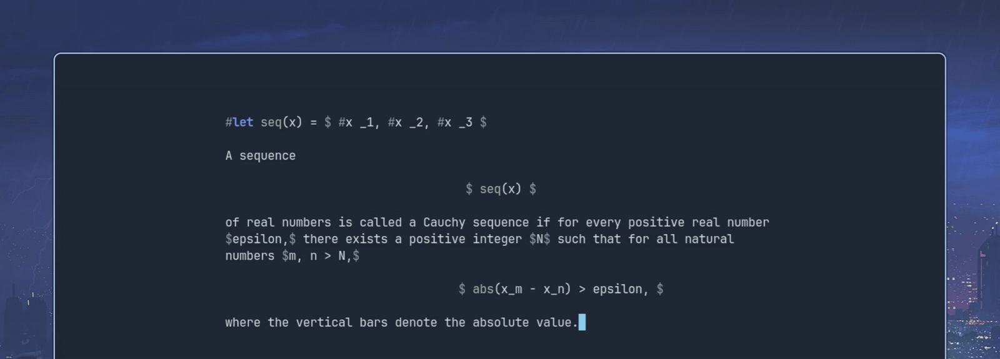
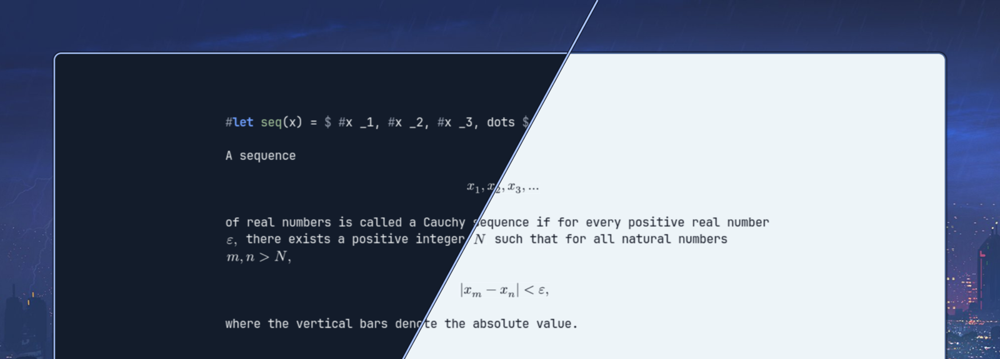

#+title: typst-overlay
#+author: Hesam Pakdaman

[[https://melpa.org/#/typst-overlay][file:https://melpa.org/packages/typst-overlay-badge.svg]]

Render Typst math equations as inline overlays in Emacs. Equations are asynchronously compiled to SVG using the =typst= compiler and displayed on top of the source text. Overlays are visible when the cursor is outside the equation and hidden when the cursor moves inside, revealing the raw source for editing. Inline equations sit on the baseline of the text around them, like the math in a typeset document.

** Supported modes
- =org-mode= — renders =$...$= as Typst math, following Typst's rules: =$x$= is inline and =$ x $= is display. Math may nest, as in =$#table($x$)$=. Write =\$= for a literal dollar sign. Math may span lines within a paragraph, and is ignored in code, verbatim and src blocks. Definitions go in Typst export blocks, see below.
- =typst-ts-mode= — renders all math equations in Typst documents

** Requirements
- Emacs 29.1 or later, built with SVG support (most builds are)
- [[https://typst.app][typst]] compiler available on =PATH=
- [[https://github.com/uben0/tree-sitter-typst][Tree-sitter grammar for Typst]], used to find equations in both modes. It is already installed if you use =typst-ts-mode=; otherwise run =M-x treesit-install-language-grammar=.

** Installation
typst-overlay is on [[https://melpa.org/#/typst-overlay][MELPA]]. With MELPA in =package-archives=, install it with =M-x package-install RET typst-overlay=, or with =use-package= in the recommended configuration:
#+begin_src emacs-lisp
  (use-package typst-overlay
    :ensure t
    :custom
    ;; Report equations that fail to compile to Flymake in Typst
    ;; buffers too, not only in org buffers (see below)
    (typst-overlay-use-flymake t)
    ;; Optional: shown values are the defaults
    (typst-overlay-scale 1.0)
    (typst-overlay-max-active-compiles 8)
    (typst-overlay-idle-refresh-delay 0.25)
    :hook ((typst-ts-mode . typst-overlay-mode)
           (typst-ts-mode . flymake-mode)))
#+end_src
To render math in org buffers too, add =(org-mode . typst-overlay-mode)= and =(org-mode . flymake-mode)= to =:hook=.

** Usage
Enable the minor mode with =M-x typst-overlay-mode=, or with a hook as above, and the buffer's equations are rendered. Editing an equation removes its overlay, and it is rendered again once you stop typing for =typst-overlay-idle-refresh-delay= seconds. To refresh only when you ask, set that option to =nil= and run =M-x typst-overlay-refresh=, or add =typst-overlay-save-refresh= to =after-save-hook= to refresh on save.

Equations are drawn in the color of the text around them, so they follow your theme, light or dark, without being compiled again:

While point is inside an equation you see its source, with its image beside it in a thin box (face =typst-overlay-preview=):

#+BEGIN_HTML

#+END_HTML

If the equation spans lines, the image is shown below it instead. It keeps up as you type, and goes away when point leaves the equation. Set =typst-overlay-preview= to =nil= to turn it off.

Equations that fail to render get a dotted red underline (face =typst-overlay-error=); move point into one, or hover over it, to see the error. They can also be reported to Flymake (see below), which on Emacs 31 or later can show the error under the equation, here with =flymake-show-diagnostics-at-end-of-line= set to =fancy=:

#+BEGIN_HTML

#+END_HTML

=M-x typst-overlay-version= shows the version you have. From MELPA it is a date, the time of the commit MELPA built, as MELPA numbers its versions; from MELPA Stable or a checkout, it is the =Version:= header of =typst-overlay.el=, that of the last release.

** Definitions
Each equation is compiled with the =#let=, =#import= and =#include= code before it, as Typst would see it, so it can use the functions and variables defined there. In Typst buffers that is the code written before the equation, in its scope. In org buffers it is the code in the Typst export blocks before it:

#+BEGIN_HTML

#+END_HTML

Other blocks, such as =#+begin_src typst=, are left out, and so is other code in the export blocks, such as =#set= rules, which would change how every equation is drawn. Org passes an export block through only to the exporter it names, so an exporter to Typst puts these definitions in the document, and other exporters leave them out.

=C-c '= opens a block in =typst-mode=, the mode org expects for Typst. To edit it in =typst-ts-mode= instead, with its equations rendered by the hook above, and to highlight Typst src blocks with it:
#+begin_src emacs-lisp
  (with-eval-after-load 'org-src
    (add-to-list 'org-src-lang-modes '("typst" . typst-ts)))
#+end_src

Code for every buffer, such as =#set= and =#show= rules, goes in =typst-overlay-extra-prelude=, which can also be set per project in =.dir-locals.el=.

When a file an equation reads changes, the equation is rendered again on the next refresh. That is a file its code imports or includes, and with typst 0.14 or later, also the files that one imports or reads in turn, such as with =json(...)=. A file that is missing is noticed when it is created, so an equation that failed because of it renders.

** Cache
Rendered equations are saved as SVG files in =typst-overlay-cache-directory=, by default =~/.cache/typst-overlay/= (=~/Library/Caches/typst-overlay/= on macOS, =%LOCALAPPDATA%\typst-overlay\= on Windows), so reopening a file shows them without compiling again. Nothing is written next to your files. Each folder of files gets its own folder there, named after its path as for backup files: =/home/me/notes/= becomes =!home!me!notes!=. Buffers without a file, such as those of =org-capture=, use their own folder's. Images not shown for =typst-overlay-cache-max-age= days, 30 by default, are deleted, checked at most once a day while Emacs is idle; set it to =nil= to keep them. The directory, or a folder in it, is also safe to delete at any time, and equations are compiled again as needed.

Before version 0.7.0 they were saved in a =.typst-overlay-cache= directory next to each file. Those directories are no longer used and can be deleted.

** Flymake
In org buffers, turn on =flymake-mode= alongside =typst-overlay-mode= and equations that fail to compile are reported to Flymake: listed by =flymake-show-buffer-diagnostics= and visited with =flymake-goto-next-error=. No language server checks math in org buffers, so typst-overlay is the only source of these errors there.

In Typst buffers this is opt-in, by setting =typst-overlay-use-flymake= to =t= as in the recommended configuration, since a language server may check them already. Set it to =nil= to never report to Flymake.

In buffers managed by Eglot, for example with =tinymist=, typst-overlay reports alongside the language server, whether Eglot starts before or after =typst-overlay-mode=. Typst stops at the first evaluation error in a document, so the language server reports those one at a time, while typst-overlay compiles each equation on its own and reports them all. An equation that both report shows up twice; with Flymake 1.4 or later (Emacs 31), typst-overlay's entry is labeled =typst-overlay=.

Errors are those of the last refresh, so they update when overlays are refreshed, shortly after you stop typing.

** Configuration
All options are available via =M-x customize-group RET typst-overlay=.
|-------------------------------------+---------------------------+---------------------------------------|
| Variable                            | Default                   | Description                           |
|-------------------------------------+---------------------------+---------------------------------------|
| =typst-overlay-scale=               | =1.0=                     | Equation size relative to the text    |
| =typst-overlay-cache-directory=     | =~/.cache/typst-overlay/= | Directory for cached SVG files        |
| =typst-overlay-cache-max-age=       | =30=                      | Days before unused images are deleted |
| =typst-overlay-max-active-compiles= | =8=                       | Max concurrent compilation processes  |
| =typst-overlay-extra-prelude=       | =""=                      | Extra typst prelude code              |
| =typst-overlay-idle-refresh-delay=  | =0.25=                    | Idle seconds before re-rendering      |
| =typst-overlay-preview=             | =t=                       | Show the edited equation beside it    |
| =typst-overlay-system-fonts=        | =nil=                     | Let typst use the system's fonts      |
| =typst-overlay-font-paths=          | =nil=                     | Extra folders to search for fonts     |
| =typst-overlay-use-flymake=         | =org=                     | Where to report errors to Flymake     |
|-------------------------------------+---------------------------+---------------------------------------|

** Fonts
Typst draws math in the fonts it comes with, and by default it does not look for the fonts installed on the system. Looking through them can take most of a second every time typst starts, which is far longer than compiling the equations. If a prelude sets a font of your own, such as =#show math.equation: set text(font: "Fira Math")=, add the folder that holds it to =typst-overlay-font-paths=, or set =typst-overlay-system-fonts= to =t=. A font typst cannot find is reported in the =*Warnings*= buffer.

** Running tests
#+begin_src sh
  emacs --batch -Q -L . -l test/typst-overlay-test.el -f ert-run-tests-batch-and-exit
#+end_src
The equation detection tests are skipped if the Typst tree-sitter grammar is not installed.

** Contributing
Bug reports and patches are welcome.

** License
GPL-3.0
